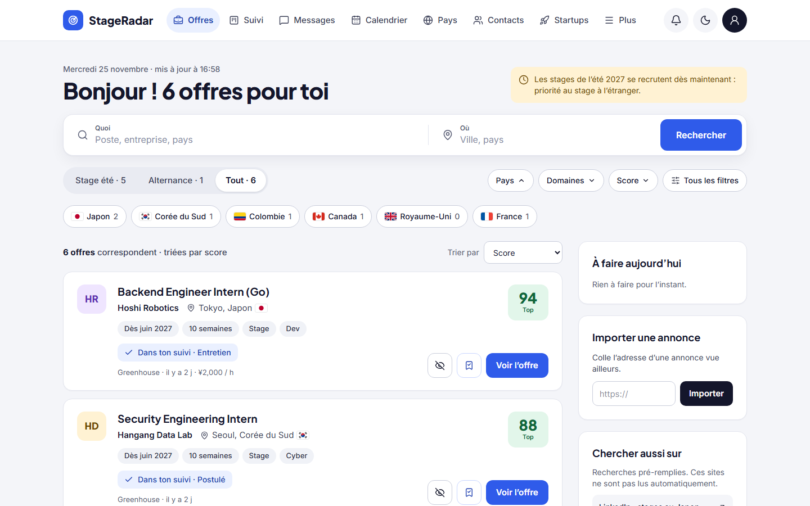
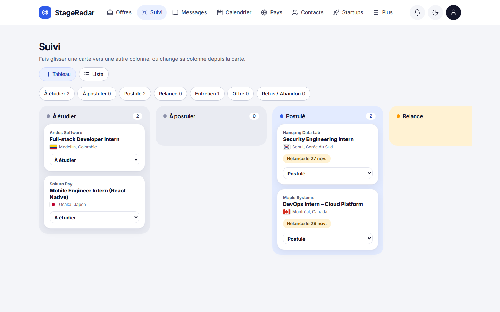
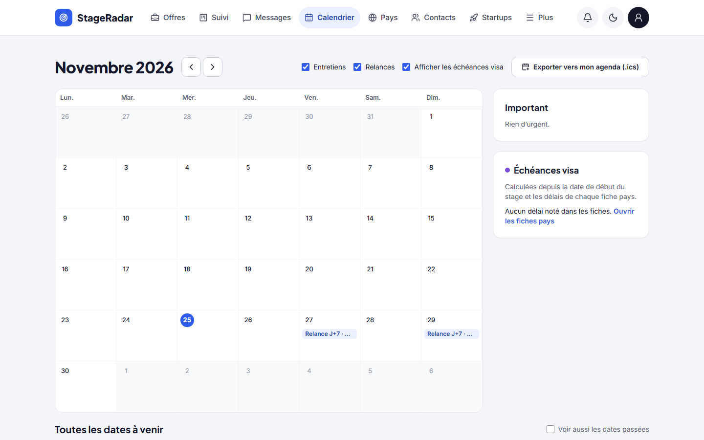
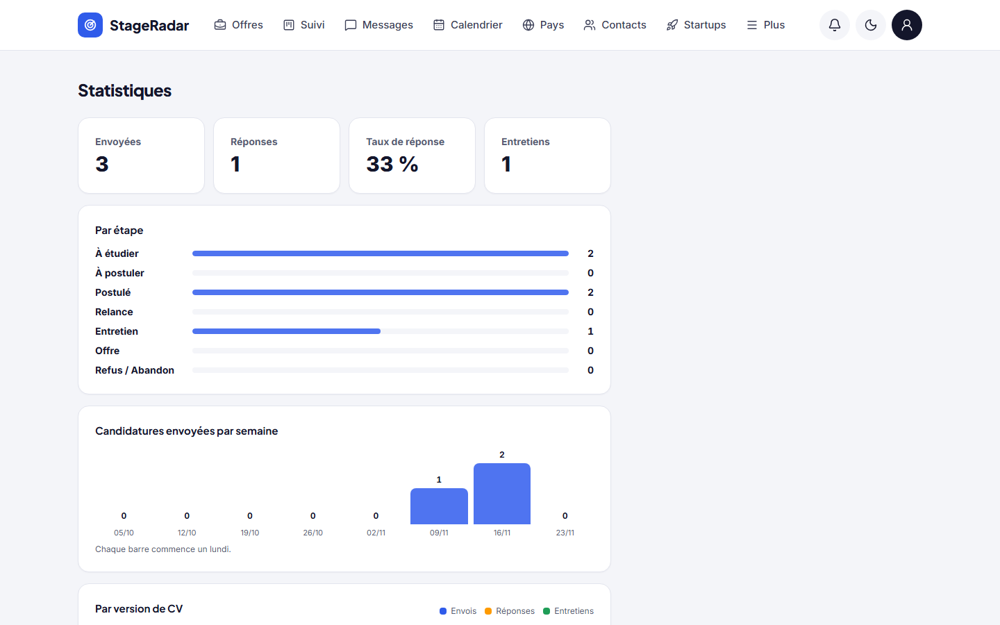
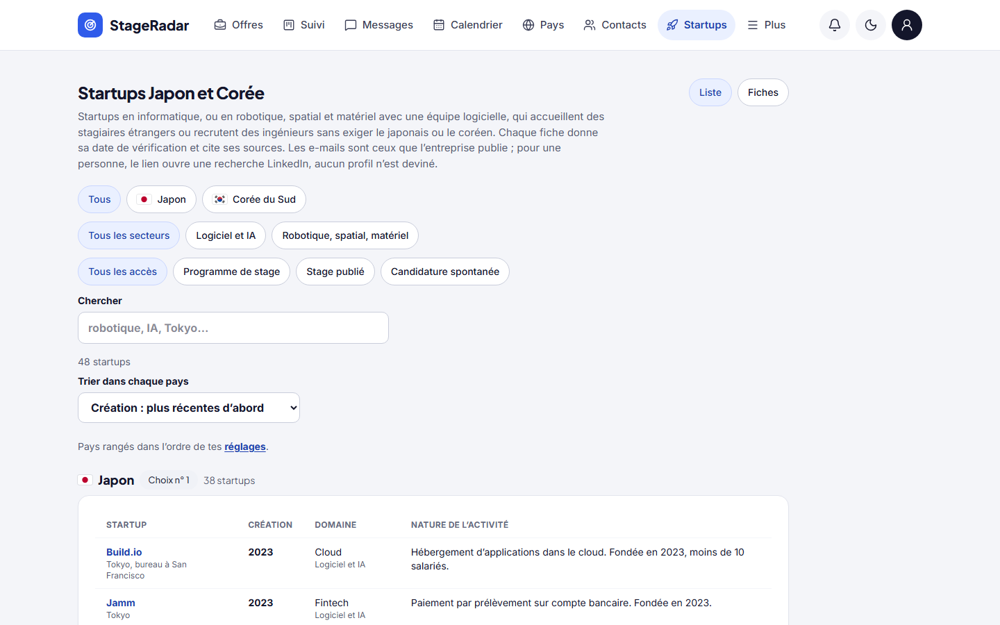
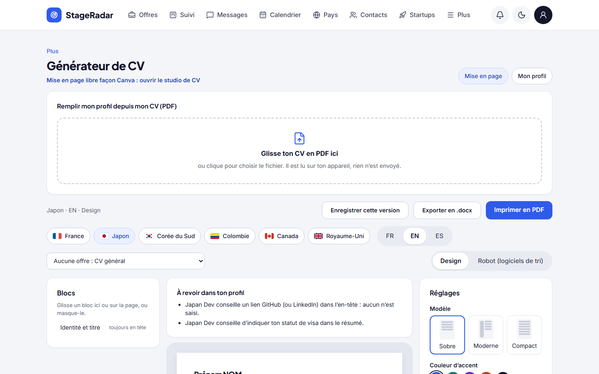

# StageRadar

Suivi de recherche de stage et d'alternance : offres, candidatures, CV, startups. 
Internship and work-study search tracker: offers, applications, CVs, startups.

| | |
| --- | --- |
|  |  |
|  |  |

Captures prises avec des données fictives. · Screenshots taken with fictional data.

<b>🇫🇷 Français</b> (cliquer pour ouvrir)

 

Application web installable (PWA, Windows et Android) que j'utilise pour ma propre recherche :
des offres d'alternance en France et de stages d'été à l'étranger (Japon, Corée du Sud,
Colombie, Canada, Royaume-Uni), et le suivi de mes candidatures du premier contact à la
réponse. Mono-utilisateur, auto-hébergée sur un VPS, à 0 €.

### Fonctionnalités

- **Collecte automatique** toutes les 6 heures sur les sites carrières (API Greenhouse, Lever,
  Ashby) : filtre par pays, classement par domaine (dev, cyber, DevOps), langues, niveau et
  période, **note de 0 à 100** expliquée critère par critère, dédoublonnage.
- **Import manuel** d'une annonce par son adresse, depuis le partage Android ou un favori.
- **Suivi des candidatures** en tableau ou en liste, relances à J+7 et J+14, calendrier des
  entretiens et relances avec export `.ics`, notifications.
- **Générateur de CV par pays** (France, Japon, Corée du Sud, Colombie, Canada, Royaume-Uni)
  selon des règles sourcées, adaptable à une offre, export PDF et `.docx`, studio de mise en
  page façon Canva.
- **48 startups** au Japon et en Corée où l'anglais suffit, vérifiées avec leurs sources.
- **Fiches pays**, logement et budget, statistiques, documents, messages, hors ligne.

### Technologies

React, Vite, TypeScript, Tailwind CSS, PWA · Postgres, GoTrue et PostgREST (briques Supabase)
en Docker sur le VPS, nginx, Let's Encrypt · collecteur Node.js lancé par cron · Vitest,
Playwright (tests sur mobile et bureau), PGlite pour tester les migrations · GitHub Actions.

### Sécurité

- Row Level Security sur toutes les tables : seul le propriétaire lit et écrit ; inscriptions
  fermées.
- Secrets générés sur le serveur, qui n'en sortent jamais ; Postgres n'écoute sur aucun port.
- nginx limite les essais de connexion ; politique de sécurité de contenu stricte.

### Code source

Ce dépôt est une vitrine : l'application contient mes données personnelles et reste privée.
Je peux montrer le code sur demande.

<b>🇬🇧 English</b> (click to open)

 

Installable web app (PWA, Windows and Android) that I use for my own search: work-study offers
in France and summer internships abroad (Japan, South Korea, Colombia, Canada, United
Kingdom), and tracking my applications from first contact to the answer. Single-user,
self-hosted on a VPS, at €0.

### Features

- **Automatic collection** every 6 hours from career sites (Greenhouse, Lever, Ashby APIs):
  filtered by country, classified by field (dev, cyber, DevOps), languages, level and period,
  **scored from 0 to 100** with an explanation for each criterion, duplicates removed.
- **Manual import** of a posting from its URL, the Android share menu or a bookmark.
- **Application tracking** as a board or a list, follow-ups at D+7 and D+14, calendar of
  interviews and follow-ups with `.ics` export, notifications.
- **CV generator by country** (France, Japan, South Korea, Colombia, Canada, United Kingdom)
  following sourced rules, adaptable to an offer, PDF and `.docx` export, Canva-style layout
  studio.
- **48 startups** in Japan and Korea where English is enough, checked with their sources.
- **Country guides**, housing and budget, statistics, documents, messages, offline mode.

### Tech stack

React, Vite, TypeScript, Tailwind CSS, PWA · Postgres, GoTrue and PostgREST (Supabase building
blocks) in Docker on the VPS, nginx, Let's Encrypt · Node.js collector run by cron · Vitest,
Playwright (tests on mobile and desktop), PGlite to test migrations · GitHub Actions.

### Security

- Row Level Security on every table: only the owner can read and write; sign-ups are closed.
- Secrets are generated on the server and never leave it; Postgres listens on no port.
- nginx rate-limits login attempts; strict Content Security Policy.

### Source code

This repository is a showcase: the app holds my personal data and stays private.
I can show the code on request.

---

Alexis Renazé – [github.com/Optiware](https://github.com/Optiware)
